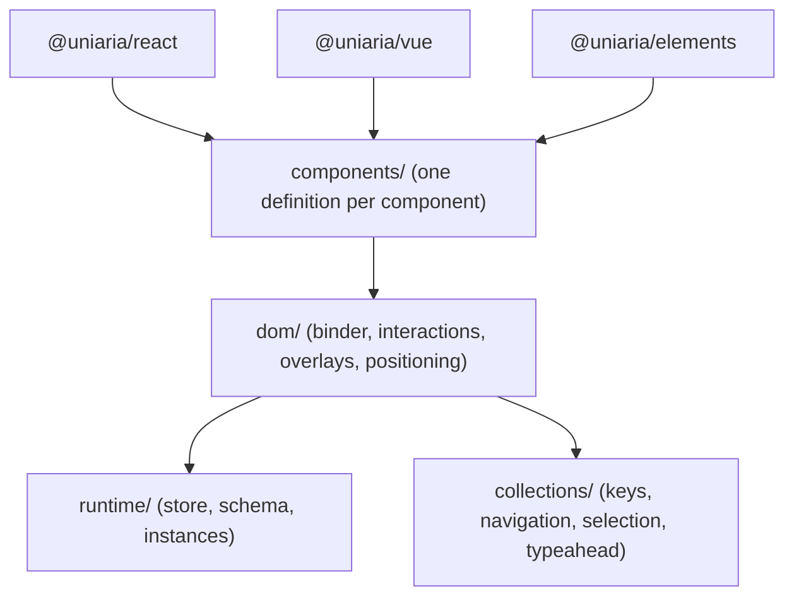
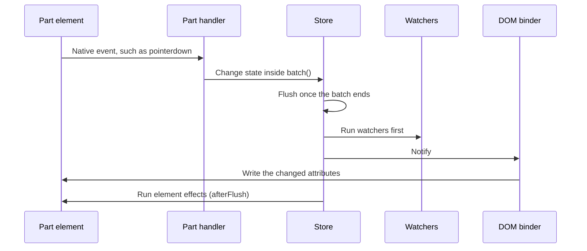
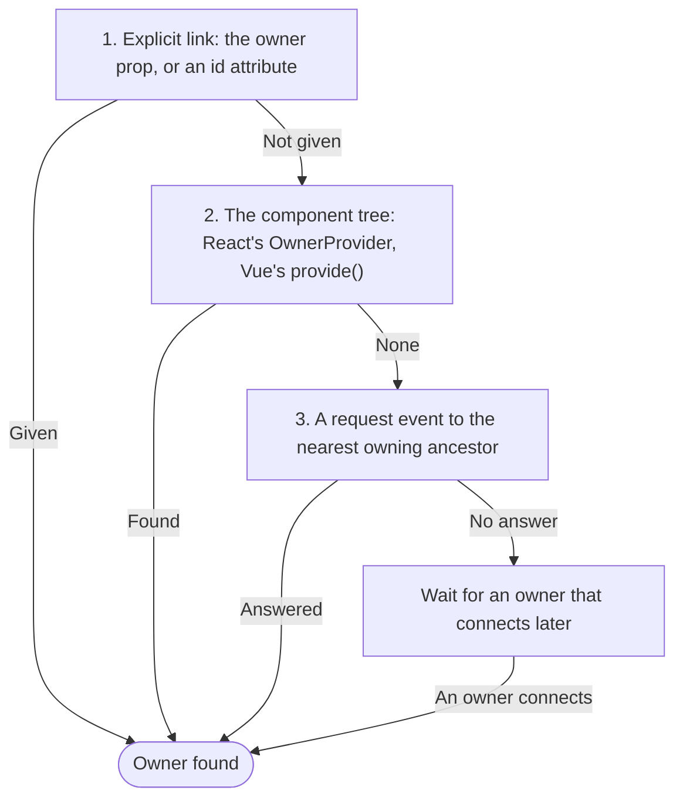

UniAria is one implementation of each component's behavior with thin
bindings. A component is a _definition_: plain TypeScript that holds its
state, handles its events and computes the attributes of its parts. The React,
Vue and custom-elements adapters run every definition through the same
runtime and write to the DOM through the same binder. This page goes through
those pieces from the bottom up.

The rules behind it are binding and live in the
[root `AGENTS.md`](https://github.com/tenphi/uniaria/blob/main/AGENTS.md)
(Architecture rules) and the package `AGENTS.md` files. Changing any of them
needs the owner's approval.

## Layers



An arrow means "may import": a layer may use the layers below it and never
one above. `components/`, `dom/`, `runtime/` and `collections/` are folders
in `packages/core/src/`.

- **The core is DOM-free at the bottom.** `runtime/` and `collections/`
  compile a second time, in `pnpm typecheck`, with `tsconfig.core.json`,
  which has no DOM lib. A `document`, `window`, `Event` or element type there
  fails the type check, as a value or as a type. The only host globals they
  may use are in `packages/core/types/host.d.ts` (timers, `queueMicrotask`
  and `console.warn` and `console.error`); everything else reaches them
  through `ctx.env`.
- **No framework code in the core.** `@uniaria/core` never imports React or
  any other framework, and the adapters hold no component-specific behavior.
- **ESLint enforces it.** The architecture-boundary blocks at the end of
  `eslint.config.js` reject upward imports and framework imports, and forbid
  `stopPropagation` and `stopImmediatePropagation` in `components/`.
- **Nothing runs at import.** No module touches `document` or `window` at
  module scope, so every entry imports in Node. The `ssr-safety.test.ts`
  files of `@uniaria/core` and the adapters import each entry in the `node`
  test project.

`@uniaria/core` publishes the runtime as `.`, `dom/` as `./dom`,
`collections/` as `./collections`, the virtualizer as `./virtual` and each
component as its own subpath (`./button`).

## The runtime

### Definitions

Each component is one `defineBehavior()` call in
`packages/core/src/components/<name>/`:

| Field                        | What it holds                                                                                                                                 |
| ---------------------------- | --------------------------------------------------------------------------------------------------------------------------------------------- |
| `name`                       | The kebab-case name. It becomes the element name, `<uni-<name>>`, the root's `data-uni` and the start of each outside part's `data-uni-part`. |
| `parts`                      | The named parts the consumer renders. Each but `root` and `outsideParts` is marked with its name capitalized as `data-element`.               |
| `outsideParts`               | The parts rendered outside the root, as an overlay's trigger and anchor are, marked `data-uni-part="<name>-<part>"`.                          |
| `props`                      | The schema: `prop(default, options?)` for plain values, `bindable(default, { event? })` for stateful ones.                                    |
| `events`                     | `event<Detail>()` for each event the component reports.                                                                                       |
| `setup(ctx)`                 | Runs once per instance. Creates state, interactions, watchers and effects, and returns the actions and readers consumers see as `api`.        |
| `expose(view)`               | The public state that selectors read. It is public API, and the spec documents it.                                                            |
| `connect(view)`              | A pure function of the current state that returns the props of every part. It runs after every flush, so it stays cheap.                      |
| `owner`, `links`, `provides` | How the component finds other instances. See [Owners and links](#owners-and-links).                                                           |
| `itemParts`, `connectItem`   | Parts repeated per collection item. See [Collections and item parts](#collections-and-item-parts).                                            |

The schema is the one source for the React adapter's props, the element's
attributes and properties, and the events. The adapters derive every name from it:

- A plain prop's attribute is its kebab-case name without an `is` or
  `should` prefix: `isDisabled` → `disabled`, `shouldPreventFocusOnPress` →
  `prevent-focus-on-press`. `attribute: false` makes a prop a property only.
- A bindable `isOpen` is seeded by `defaultOpen` (attribute `default-open`)
  and reports `openChange`: the DOM event `openchange` and the React callback
  `onOpenChange`.
- `adopt` lets an element read a prop the consumer left unset from a part:
  its tag (Button's `elementType`), an attribute (Button's `href`), a live
  property (TextField's input `value`) or, for a collection, the item parts
  in the markup. A bindable adopts into its `default<Name>`, so it stays
  uncontrolled.

`defineBehavior()` throws when the name isn't kebab-case, when two props or
events would produce the same React prop, and when item parts come without
`connectItem()`.

A sketch of the shape, without the interactions a real component uses
(`createPress`, `createFocus` and the rest of `dom/`):

```ts
import { bindable, defineBehavior, prop } from '@uniaria/core';

export const disclosure = defineBehavior({
  name: 'disclosure',
  parts: ['trigger', 'panel'],
  props: {
    isOpen: bindable(false),
    isDisabled: prop(false),
  },
  setup({ props }) {
    return {
      toggle() {
        if (!props.isDisabled()) props.isOpen.set(!props.isOpen.get());
      },
    };
  },
  expose: ({ props }) => ({ isOpen: props.isOpen.get() }),
  connect: ({ props, ids, api }) => ({
    trigger: {
      attrs: {
        'aria-expanded': String(props.isOpen.get()),
        'aria-controls': ids.panel,
        'data-open': props.isOpen.get() ? '' : undefined,
      },
      on: { click: api.toggle },
    },
    panel: {
      attrs: { id: ids.panel, hidden: props.isOpen.get() ? undefined : '' },
    },
  }),
});
```

### Instances

`createInstance(definition, { props, id, env })` creates the running
component every adapter drives: its props, its store, the `api` its `setup()`
returned and its lifecycle. A part's id is the id its element carries, else
the prop that names it (`idOf`, such as `controlId`), else `<id>-<part>`;
React and Vue pass an id from their `useId()`, and an element gets a
generated one.

Node tests drive definitions through it directly, without a framework or a
DOM: call actions or part handlers from `instance.connect()`, then read
`attrs` and `getState()`.

```ts
const instance = createInstance(disclosure);
instance.api.toggle();
instance.getState().isOpen; // true
instance.connect().trigger.attrs['aria-expanded']; // 'true'
```

### The store

Each instance has one store (`runtime/store.ts`). Its snapshot is a version
counter: stable between changes, as React's `useSyncExternalStore` requires,
and moved once per flush. There is no fine-grained tracking. An instance
holds few values, `connect()` is cheap, and the binder compares its output
with the DOM anyway.

- `ctx.state(initial)` returns a cell. Setting a different value (by
  `Object.is`) marks the store changed, and the store flushes unless a batch
  is open.
- `store.batch(fn)` holds the flush until the outermost batch ends, so one
  action notifies once. Every handler `connect()` returns runs inside a
  batch. Interactions batch the document listeners they add themselves, with
  `ctx.batch()`.
- A flush moves the version and calls the listeners. A change a listener
  makes doesn't flush in the middle of that pass: the store runs one more
  pass, so every listener sees each version once. After 100 passes in a row
  it logs an error and stops, since a listener keeps changing state.
- `instance.connect()` and `instance.getState()` are cached until state or
  props change.

### Bindables

A bindable is a value that is controlled when the consumer passes it and
uncontrolled otherwise. `setup()` sees it as `get()`, `set(value)`,
`isControlled()` and `reset(options?)`.

- **Uncontrolled:** `set()` commits the value, notifies and calls the change
  callback. `default<Name>` seeds the value until the first uncontrolled
  change, like a form control's `value` attribute, so a default that arrives
  late (an attribute the parser adds after the element is created) still
  applies.
- **Controlled:** `set()` only calls the change callback. The value changes
  when the consumer passes a new prop. Never assume a requested change took
  effect.
- **Form reset** goes through `reset()` in every form component, as a native
  reset does: an uncontrolled value forgets its changes and follows
  `default<Name>` again; a controlled one asks for `default<Name>`, or
  without one the value it mounted with, except in a composed definition
  ([Composition](#composition)). Never put back a value captured at mount
  on an uncontrolled bindable: a custom element's default often arrives
  after it connects.
- The runtime reads props only through getters and never keeps a copy.

### `setProps()` and `sync()`

`instance.setProps()` stores new props without notifying anyone, because a
notification during a React render triggers React's update-while-rendering
warning. The adapter calls `instance.sync()` once the new props are
committed: React in a layout effect after each commit, an element right
after an attribute or property changes. `sync()` notifies only when a value
other than a callback changed since the last sync (callbacks get a new
identity on every render), so watchers and the binder run once per real
change.

### Watchers, effects and memos

- `ctx.watch(read, callback)` compares `read()` by `Object.is` after each
  flush and calls back with the new and the previous value. The instance
  subscribes its watchers before any adapter subscribes, so they settle
  state, in a batch, before the binder and selectors read it.
- `ctx.effect(fn)` runs `fn` on `start()` and its cleanup on `stop()`.
- `ctx.afterFlush(fn)` runs `fn` once the flush under way has called every
  listener, the binder included (at once when none is). Element effects
  (`partEffect`, `elementEffect`) and other DOM work that depends on them
  (placing a popover, scrolling an option into view) go through it, so they
  see the parts as the binder wrote them: an overlay shown there is
  `data-entering` from its first style. Reading what the markup had before
  the binder writes over it (a checkbox `checked` in the markup) belongs in
  a watcher or an effect instead.
- Watchers and effects are live only between `start()` and `stop()`, which
  never run on the server. Both are idempotent and restartable, since React's
  StrictMode mounts twice.
- `ctx.memo(deps, compute)` caches a derived value by explicit dependencies.
- `ctx.emit(name, detail)` calls the consumer's `on<Name>` callback; the
  element adapter turns it into a DOM event.



## Part props

`connect()` returns framework-neutral props for each part. In outline:

```ts
interface PartProps {
  attrs: Record<string, string | undefined>; // undefined removes the attribute
  on?: Record<string, (event: Event) => void>; // keyed by DOM event name
  style?: Record<string, string | undefined>; // custom properties, layout styles
  properties?: Record<string, string | number | boolean | undefined>;
}
```

- **`attrs`.** ARIA values are strings: `'true'` and `'false'`, never
  booleans. State attributes such as `data-pressed` are present (`''`) or
  absent, never `"false"`. The instance adds the part markers
  (`partMarker()`): the root gets `data-uni="<name>"`, an outside part
  `data-uni-part="<name>-<part>"`, and every other part `data-element` (its
  name capitalized, as Tasty names a sub-element).
- **`on`.** DOM event names: `click`, `keydown`, `focusin`, `focusout`,
  `input`. Use `focusin` and `focusout` for focus entering or leaving a
  subtree. Handlers read only native events.
- **`style`.** CSS custom properties, plus the layout properties a definition
  positions its parts with (a virtualized list's rows). `undefined` removes
  one.
- **`properties`.** Live DOM properties that no attribute holds once the user
  acts: an input's `value`, a checkbox's `checked` and `indeterminate`. They
  are set only when they differ from the element; `undefined` leaves one
  alone.

The runtime types handlers as `(event: never) => void`, so it needs no DOM
types. Definitions type their part props with `DomPartProps` from `dom/`,
which gives each handler its real event type, and read part elements with
`partElement(ctx, part)`.

## The DOM binder

`createBinder(instance, { host? })` in `packages/core/src/dom/binder.ts` is
shared by every adapter. An adapter renders each part once and hands the
binder its element: React and Vue through the part's `ref`, an element
through part discovery. From then on the binder subscribes to the store, runs
`connect()` after every flush and writes only what differs. Every adapter
starts the instance and then the binder inside one `instance.batch()`, so the start's
element effects run after the binder's first write:

- It compares with the element itself, not with what it wrote last, so a
  framework render that writes the same attributes never leaves the two out
  of step.
- It owns every attribute `connect()` has ever returned for a part, and
  `undefined` removes one. Every other attribute belongs to the consumer.
- Except a part's `id` (owner, 2026-10-19): a part keeps an id its element
  carries. The binder reads it as the element attaches, before each write
  and when it changes (a mutation observer), and hands it to the instance
  (`adoptId()`), so `ctx.ids` and every reference follow it. It writes an id
  only where there is none. Item parts keep the ids made from their key.
- When an element stops being a part, it removes the attributes and styles
  it wrote there that still hold what it wrote, unless another part bound to
  the element writes them too. What it never wrote (the consumer's markers
  and id, what a framework rendered) stays.
- It sets a live property only when it differs, so an input's caret stays
  where it is.
- For item parts it rewrites only the keys the instance reports changed.

### Why internal state never re-renders

Hover, press, focus, a highlight moving through a list, an overlay opening:
each is a change of internal state that only part attributes show. If each
one re-rendered the React or Vue component that owns it, it would also
re-render
everything inside: a whole form for one hover, a thousand-row list for one
arrow key. So the change goes from the store to the binder to the DOM, and no
framework render happens. This is the reason UniAria exists.

- A component re-renders for state only when it selects it with
  `useBehaviorState`, and only when the selected value changes.
- Every render reads the current state, so a parent's re-render writes the
  values the binder already set. The two never fight.
- Every adapter writes through the same binder, so React, Vue and custom
  elements produce the same DOM.
- What still renders: controlled props arrive through normal renders, and
  changing the rendered tree by state (other content, lazy mounting) needs a
  selector. Overlays stay mounted in the top layer, so opening one renders
  nothing.

## Adapters

### React

`useBehavior(definition, props)` in `packages/react/src/use-behavior.ts`:

1. Creates the instance on the first render, with an id from `useId()`. Later
   renders call `setProps()`, silently.
2. Returns `parts`: each part's current props as React props (attribute names
   mapped, such as `tabindex` → `tabIndex`; boolean attributes as `true`),
   stable handlers and a stable `ref`. A handler keeps its identity across
   renders and calls the handler from the latest `connect()` with
   `event.nativeEvent`. Event names map too: `focusin` → `onFocus`,
   `focusout` → `onBlur`, `input` → `onInput`.
3. Renders `value` and `checked` once, from the first render, as
   `defaultValue` and `defaultChecked`. React never controls the element, and
   the server HTML shows the starting value.
4. In a layout effect, starts the instance and the binder, and answers owner
   requests when its definition can be an owner. Another layout effect after
   every commit calls `sync()`.
5. Gives item parts their props through `getItemProps(part, key)`. Each row's
   `ref` reaches the binder in one batch per commit.

In development it warns when an element's attributes differ from what React
just rendered: the consumer passed an attribute the binder owns.

`useBehaviorState(instance, selector, isEqual?)` reads one selected value
through `useSyncExternalStore` and re-renders only when it changes
(`Object.is` by default). The snapshot is the selected value, cached per
state object, so it stays stable between changes. It skips the notification
from the post-commit `sync()` when it already rendered the value that
notification brings, since React records the rendered snapshot only in a
passive effect and would otherwise render every prop change twice. Never
subscribe a component to the whole store. The package holds no
component-specific code; any per-component sugar may only wrap these hooks.

### Vue

`useBehavior(definition, props)` in `packages/vue/src/use-behavior.ts`,
called in `setup()`:

1. Creates the instance in setup, with an id from Vue's `useId()`. Props come
   as a getter, a ref, a reactive object or a plain object; a pre-flush
   watcher calls `setProps()` before the render, and `sync()` runs after the
   patch (`queuePostFlushCb`).
2. Returns `parts` as a getter: each read takes the current `connect()`, so
   every render reads current state, and since the store isn't reactive, the
   read subscribes the render to nothing. Attribute names stay DOM names,
   events become `on` + the capitalized DOM name (`onKeydown`, `onFocusin`),
   and handlers are stable.
3. Renders `value` and `checked` once, from the first render, as `^value`
   and `^checked`: attributes only, so Vue never controls the element.
4. Vue calls a function ref during the patch, and on first mount before the
   element is in the document. Refs only record elements, which reach the
   binder after the patch, in one batch: in `onMounted` before the instance
   starts, or in a post-flush callback.
5. In `onMounted` (and `onActivated`), starts the instance and the binder and
   answers owner requests; `onDeactivated` and `onBeforeUnmount` stop them.

It warns in development as React does, including about attributes a parent
lets fall through onto a part. `useBehaviorState` returns a `customRef` that
reads the state when it is read and triggers only when the store's
notification changes the value a render last read, so a prop change renders
once. Owners go through `provide()`: every `useBehavior` provides its
instance, and finds its owner by `inject()` during setup.

### Custom elements

`defineElement(definition, options)` in
`packages/elements/src/define-element.ts` creates the element class inside the
call, so the package imports in Node, and registers `<prefix>-<name>` (`uni-`
by default). It returns the existing class when the name is already defined,
and `undefined` where there is no `customElements`. Each component but
TextInput, which only definitions compose, has a registering entry,
`@uniaria/elements/<name>`.

- **Props in through properties and attributes.** There is one property per
  prop, plus `default<Name>` for each bindable. A plain prop also has an
  attribute; a bindable's attribute is `default-<name>`, which seeds it, and
  setting its property makes it controlled (`undefined` uncontrolled again).
  Reading a bindable's property gives the current value as the instance's
  state has it, else through `instance.getValue()`, so `el.value = el.value`
  controls it; other
  properties read what was set. A boolean attribute is true when
  present, except `"false"` on a prop that defaults to true. Properties a
  framework set before the element was defined are applied on upgrade.
- **Events out.** Every event and change event is dispatched on the host as
  a bubbling, non-composed `CustomEvent`, with the value in `detail`.
- **Lifecycle.** `connectedCallback` finds the parts, starts watching for new
  ones, answers owner requests, links to its owner, then starts the instance
  and the binder in one batch;
  `disconnectedCallback` calls `stop()`; `attributeChangedCallback` calls
  `setProps()` and then `sync()`.
- **State.** `element.instance` is the instance; `element.instance.getState()`
  reads the public state.

How the element treats the consumer's markup is covered under
[Custom elements in the light DOM](#custom-elements-in-the-light-dom).

## Composition

`ctx.use(definition, props, options?)` composes another definition into the
current instance. The composed definition:

- runs its `setup()` on the same instance: the same store, lifecycle and
  elements;
- reads its props from the `props` function on every access, so the
  composing definition passes its own props and callbacks through, and
  receives the composed one's events through those callbacks;
- renders on the composing component's parts of the same name, or as
  `options.parts` maps them (`null` leaves a part out). A part with neither
  is left out too, and the binder warns about it once per page in
  development, since the DOM-free runtime can't tell a development build.
  So a control that gains an optional part doesn't break the definitions
  that compose it;
- reads through `ctx.link()` only the links the composing definition hands
  it in `options.links`, which the composing definition then no longer
  reads, so one definition drives a linked instance;
- returns `api`, `actions`, `state()`, `connect()` and `connectItem()`,
  which the composing definition folds into its own `expose()` and
  `connect()`.

A composed definition's bindable that the composing definition controls
ignores `reset()`: the value is the composing definition's, which resets
its own on a form reset.

That is how there is exactly one implementation of each behavior, at two
levels. Controls are behaviors for one widget: Button, ToggleButton,
TextInput, Listbox, Autocomplete, Popover and Dialog. Fields put Field
around a control and hold a form value. TextField is Field and TextInput,
NumberField adds two Buttons to them, Select composes Field, Listbox,
Popover and a Button trigger, and Combobox is Autocomplete (Field,
TextInput and Listbox) and Popover. A control is labelled by one Field:
TextInput has none of its own, Listbox and Autocomplete carry Field's
parts as optional parts, and a composite maps them rather than composing a
second Field.

`api` is internal. UniAria's components read each other's, which is safe
because they ship in one version. A definition outside UniAria relies only
on the props it passes and the events they report, `state()`, `connect()`,
`connectItem()`, `actions`, and part and link names
([Custom components](../guide/custom-components.md#build-on-the-controls)).

## Owners and links

Separate instances that work together link through an owner: a radio
belongs to its radio group, a checkbox to its checkbox group. The child's definition names it,
`owner: { definition, attribute }`, and reads it with
`ctx.owner(definition)`: the owner's `instance`, its `api` and its `state()`,
or `undefined` until it is found. Read it where it is used (`connect()`,
`expose()`, a watch). While the child is started, the owner's changes count
as its own, so the child's binder runs `connect()` again; nothing renders.

A child finds its owner in this order:

1. **An explicit link**, for parts that sit apart. In React and Vue, the
   `owner` prop takes the owner's instance. On elements, the owner attribute names
   the owner's host by id, resolved in the child's root node, like HTML's
   `for`: `<uni-radio group="plan">`. An element's `owner` property, set to
   an instance, wins over both.
2. **React context.** `<OwnerProvider owner={group}>` makes an instance the
   owner of the UniAria components rendered inside it. The context holds only
   the stable instance, never state, so it re-renders nothing. Components find
   it during render, so the first render and the server HTML know the owner,
   and React context crosses portals. Providers nest; each component takes
   the nearest owner of the definition it names. In Vue, every
   `useBehavior` provides its instance this way through `provide()`, and a
   child finds it with `inject()` during setup; it crosses `<Teleport>`.
3. **The nearest DOM ancestor.** After mount the child dispatches a bubbling
   request event from its element, in the shape of the
   [Context Community Protocol](https://github.com/webcomponents-cg/community-protocols/blob/main/proposals/context.md).
   The nearest element that provides an owner of that definition answers.



A request nobody answered waits. An owner that connects later answers the
waiting requests it matches, so mount and upgrade order don't matter. An
owner that disconnects releases its children, which ask again. The lookup
code lives in `dom/owner.ts`; the runtime sees only `ctx.owner()` and
`ctx.link()`. Tests cover each path: nested, a consumer portal in React and
a `<Teleport>` in Vue, another branch of the page, a React or Vue child
inside a custom-element owner, and an owner that connects late.

**Links** work like owners but name a small key, a `LinkKey`, instead of a
definition, so the linking component doesn't bundle the component it links
to: Button links to a Tooltip without bundling its definition. The linking
definition lists the key in `links`, the answering one in `provides`, and
`ctx.link(key)` reads it as `ctx.owner()` does. In React and Vue the
instance comes from the prop named after the key (`tooltip`). On elements it comes from the
attribute of that name, an id, or else from the UniAria host the element sits
in directly, never through another host.

## Collections and item parts

- **Items are data.** A collection component takes `items` plus `getKey`,
  `getTextValue`, `isItemDisabled` and `getChildren` (for sections), and
  `disabledKeys`. The core never derives a collection from children. A custom
  element may read its items from its markup instead, the way it adopts
  props: one item per item part (Listbox's `option`), keyed by its
  `data-key`, with its `data-text-value` or its text, and one section per
  section part (Listbox's `group`). It reads them again when they change, as
  long as the consumer sets no `items`.
- **`collections/`** (`@uniaria/core/collections`) is DOM-free: the
  flattened list with key-to-index lookups, keyboard navigation, selection
  and typeahead.
- **Item parts** repeat per item. A definition lists them in `itemParts` and
  returns their props from `connectItem(part, key)`, computed lazily for each
  rendered item, never for every row at once, and cached per part and key.
  React and Vue render them with `getItemProps(part, key)`; a custom element finds
  them by `data-element` and the consumer's `data-key`.
- **Only changed rows are rewritten.** After a flush the binder rewrites
  only the keys the instance reports invalidated: those a definition names in
  `ctx.invalidateItems(keys)`, and a key whose element attaches or detaches.
  A change of props invalidates every item. Moving the highlight through a
  long list rewrites two rows.
- **Item ids** are made from the component's id, the part and the key
  (`itemId()`), so they move with the item. Consumers can't override them.
- **`ctx.itemEffect(part, effect)`** runs per element as rows attach and
  cleans up as they detach.
- **Virtualization** is opt-in through the `virtualizer` prop.
  `@uniaria/core/virtual` wraps `@tanstack/virtual-core` behind the
  `Virtualizer` interface in `dom/virtual.ts`, so only lists that virtualize
  load it. The consumer renders the `renderedKeys` and `renderedSections`
  state, never every item, and the core positions the rows with styles
  through the binder. A custom element takes `items` as a property and
  renders on `renderedkeyschange`.

Collections stay data: owner links are for composed components, never for
collection items.

## Overlays and the layer stack

- **Top layer, no portals.** Dialog uses `<dialog>`; Popover and Tooltip use
  the Popover API. Nothing moves nodes into a portal, and overlays stay
  mounted while closed. The Popover API is newer than Baseline widely
  available, so `dom/support.ts` detects it. Without it a popover opens in
  place: `hidden` while closed, `position: fixed` while open. A development
  switch forces the fallback so tests cover both paths (see
  [Global singletons](#global-singletons)).
- **One layer stack per window** (`dom/layers.ts`). Every open dialog and
  popover joins it, including the popovers Select and Combobox compose; a
  tooltip stays off it. Escape closes the top layer only. A press
  closes every layer it is outside of, top down, and stops at a layer that
  holds it or at a modal dialog. Closing a layer closes the layers opened
  from inside it. A layer never closes itself: it calls `onDismiss` with a
  reason, and the component sets its open state.
- **No stopped propagation.** Nested layers coordinate through the stack and
  through `defaultPrevented`; components never call `stopPropagation`. So one
  click outside a popover both closes it and acts on what it hit, as in Cube
  UI Kit and the browser's own light dismiss (React Aria needs a second
  click). A press on a popover's own trigger closes it without reopening it,
  and `shouldCloseOnInteractOutside` keeps it open for chosen targets.
- **Inertness.** Popovers never make the outside inert or put an underlay
  over it; they may hide it from assistive technology with `hideOutside`
  (`aria-hidden`). A modal `<dialog>` makes the outside inert natively, so a
  press outside a dialog only dismisses it.
- **The other overlay pieces in `dom/`:** focus scopes (contain, restore and
  auto-focus), scroll lock, presence (enter and exit phases that wait for the
  stylesheet's running animations), the live announcer (an open modal dialog
  hosts it, since the page outside is inert), and a mark on focus an overlay
  restores, so a tooltip doesn't open for it.

`docs/_internal/interaction-layer.md` catalogues what each of these has to do,
the browser bugs involved and where UniAria differs from React Aria, with the
status of each area.

## Positioning

Positioning goes through one wrapper, `createPosition()` in
`dom/position.ts`. Its options are CSS Anchor Positioning's own:
`positionArea` and `positionTryFallbacks`. Gaps are the consumer's margins:
the margin facing the anchor is the gap. The page picks one of two modes with
`configure({ positioning })` from `@uniaria/core/dom`, not by detection:

| Mode       | What UniAria does                                                                                                                                                                                                                                                                                        |
| ---------- | -------------------------------------------------------------------------------------------------------------------------------------------------------------------------------------------------------------------------------------------------------------------------------------------------------- |
| `'script'` | The default. UniAria places the part itself, in every browser, by CSS's rules: `position: fixed` with `top` and `left`, the base option first and then each fallback, keeping the last option that fit while it still fits, and shifting the part into the viewport. It checks every frame while active. |
| `'css'`    | The consumer's CSS anchor positioning places the part. UniAria only writes `position-anchor` (a name it adds to the anchor's `anchor-name` list) and reads back the side the part landed on. Without anchor positioning in the browser, it warns in development.                                         |

Both modes write `--anchor-width`, `--available-width` and
`--available-height` and place the arrow part. A setting applies from the
next time a popover or tooltip opens. The default becomes CSS mode once
anchor positioning is Baseline widely available. Scenarios that place a part
run in both modes.

## Server rendering and the environment

- **Correct first HTML.** Adapters render each part with its current part
  props, so server HTML and the first paint carry the right attributes.
  `start()` never runs on the server, so neither do effects and watchers;
  React's layout effects fall back to `useEffect` there, which the server
  never runs, and Vue never runs `onMounted` there.
- **Stable ids** come from the adapter (`useId()` in React and Vue), so ARIA
  relationships match between the server and the client. Consumers can
  override every id except an item part's: a part keeps an id on its
  element. React's first render can't see the element, so server HTML refers
  to the part's own id until hydration; an `idOf` prop (`inputId`) gives the
  right one before then.
- **`ctx.env`** is the runtime's only view of the host. Today it carries the
  instance's `document`: the element adapter passes its own `ownerDocument`,
  and where React passes none, a definition falls back to the global
  `document`. The helpers in `dom/` take the window from a part element's
  `ownerDocument.defaultView` and the root from its `getRootNode()`, so
  listeners and lookups follow the document or shadow root a component lives
  in. Hiding the outside and focus scopes don't support shadow DOM yet.

## Global singletons

Whatever two copies of UniAria on one page must share is keyed with
`Symbol.for('@uniaria/…')`, so duplicate installs agree. Most of it is stored
on the window; the settings live on `globalThis`, and `@uniaria/host` is a
static property of each element class:

| Key                                                    | Holds                                                                       | Where                            |
| ------------------------------------------------------ | --------------------------------------------------------------------------- | -------------------------------- |
| `@uniaria/layers/v1`                                   | The dismissable layer stack and its document listeners                      | `dom/layers.ts`                  |
| `@uniaria/modality/v1`                                 | The input-modality tracker behind focus-visible                             | `dom/modality.ts`                |
| `@uniaria/focus-scopes/v1`                             | The focus scopes and which one is active                                    | `dom/focus-scope.ts`             |
| `@uniaria/hide-outside/v1`                             | What `hideOutside` hid, with reference counts                               | `dom/hide-outside.ts`            |
| `@uniaria/scroll-lock/v1`                              | The scroll locks held                                                       | `dom/scroll-lock.ts`             |
| `@uniaria/announcer/v1`, `@uniaria/announcer-hosts/v1` | The live announcer and the modal dialogs hosting it                         | `dom/announcer.ts`               |
| `@uniaria/pressables/v1`                               | Every pressable element, so only the innermost one handles a press          | `dom/press.ts`                   |
| `@uniaria/text-selection/v1`                           | Text selection turned off during touch presses                              | `dom/text-selection.ts`          |
| `@uniaria/restoring-focus/v1`                          | The element an overlay is giving focus back to                              | `dom/restore-focus.ts`           |
| `@uniaria/anchors/v1`                                  | A counter for unique anchor names in CSS mode                               | `dom/position.ts`                |
| `@uniaria/settings/v1`                                 | The page-wide settings from `configure()`                                   | `dom/settings.ts`                |
| `@uniaria/fallbacks/v1`                                | The development switch that forces a fallback: `{ popover: false }`         | `dom/support.ts`                 |
| `@uniaria/tooltips/v1`                                 | The open tooltip and the warm-up timing                                     | `components/tooltip/registry.ts` |
| `@uniaria/host`                                        | Marks UniAria element classes, so hosts around them leave their parts alone | `dom/parts.ts`                   |

Two of them patch the platform. The modality tracker wraps
`HTMLElement.prototype.focus` once per window, as React Aria does, and the
dialog and popover methods that move focus, so focus a script moves isn't
taken for a screen reader moving it. Scroll
lock on iOS wraps it once per window too, the first time it locks, and passes
calls through while unlocked. A wrapper is never removed: removing it would
drop any wrapper installed after it.

## Custom elements in the light DOM

The custom elements have no shadow DOM and use no Lit. The host wraps the
consumer's markup and renders nothing of its own, so the consumer's CSS and
any framework around it see plain DOM.

- **Hands off the consumer's nodes.** The element never creates, moves or
  removes nodes it didn't create. What it must create goes outside the
  consumer's tree: the live announcer, which an open modal dialog hosts
  because the page outside it is inert.
- **Element-owned parts** are the exception the definition declares: the
  consumer leaves them empty and UniAria writes their content, in both
  adapters. Select's displayed value and the `<option>`s of its hidden
  `<select>` are the two.
- **Attribute ownership is per part.** UniAria owns ARIA state, `data-state`
  and the other state attributes, and the part markers: `data-uni`,
  `data-uni-part` and `data-element`. The consumer owns content, `class` and
  every other attribute.
- **Part discovery** (`dom/parts.ts`) finds the root by `data-uni`, an
  outside part by `data-uni-part` and the other parts by `data-element`
  inside the host, minus those
  inside a nested UniAria host of any kind (a nested host can still be a part
  itself), and a `MutationObserver` picks up parts added later. A custom
  element connects before the parser adds its children, so parts often
  arrive after `start()`: anything that needs a part element goes through
  `partEffect()`.
- **Listeners are delegated from the root.** The binder adds each part's
  listeners on the host's root node, the document or a shadow root, as React
  delegates from its root container. Events that bubble are handled in the
  bubble phase, so the consumer's listeners on the path run first and can
  prevent one. Events that don't bubble, such as `pointerenter`, are handled
  in the capture phase. A bubbling event reaches every part on its path,
  innermost first, as React's handlers on each part would; one that doesn't
  bubble reaches only the part it targets. One pair of listeners per event
  type and root serves every host in it.
- **Never a listener on the host.** Chromium exposes an element with a
  `click` or `mousedown` listener as clickable, and NVDA then says
  "clickable" before every control inside it. Listeners on the document
  aren't reported.
- **Valid HTML positions only.** A host never sits between `<table>` and
  `<tr>`, inside `<ul>` or inside `<select>`.

Tests also mount the elements inside React to prove the two never fight over
DOM nodes.
